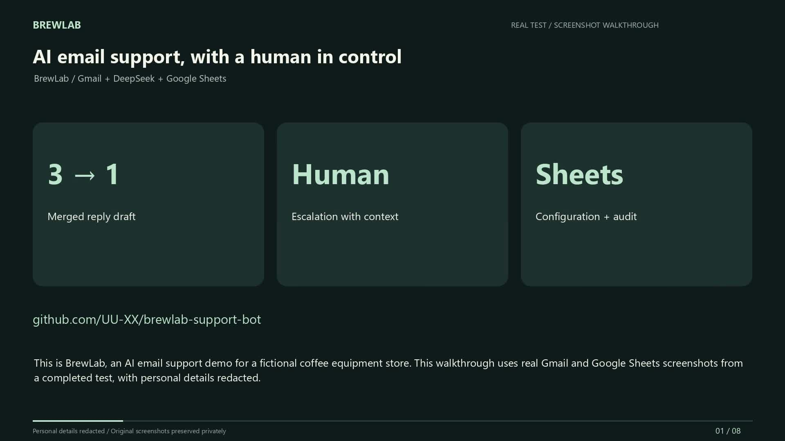
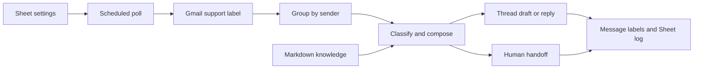

# BrewLab · AI Email Support Bot

**Python · Gmail · DeepSeek · Google Sheets**

Turn a burst of customer emails into one reviewable reply. Keep human handoff, operating hours and per-message audit logs under the support team's control.

[Recording guide](docs/DEMO.md) · [Setup guide](docs/SETUP.md) · [Test scenarios](tests/test_cases.md)

**Portfolio demo:** [English video](docs/media/BrewLab-English-Demo-With-Cover.mp4) · [Screenshots](docs/MEDIA.md) · [Live validation](docs/LIVE_VALIDATION.md) · [Portfolio copy](docs/UPWORK.md)



**Evidence status:** controlled live Gmail, DeepSeek and Google Sheets testing produced one combined draft from three incoming messages, an internal handoff with the original email attached, and four audit rows. The 1 minute 51 second English video is a narrated walkthrough of real screenshots with private details redacted, not continuous screen capture. It shows the final off setting, not an interactive mode-switch sequence. No live-mode customer reply was sent, and recipient-side handoff delivery was not independently confirmed.

Verified locally on Python 3.12: **147 regression tests and 10 offline scenarios passed**. Automated tests use simulated providers; separate live validation is documented above. GitHub Actions has not been enabled for this release. No measured accuracy, time-saving or production-use claims are made.

A small coffee equipment shop gets three emails from one shopper about a grinder, its price and shipping. Answering each email immediately creates three replies and can miss the shopper’s final question. BrewLab waits for two minutes of silence, reads the conversation and prepares one reply in the customer’s language. A support lead can review drafts, change operating hours and inspect individual message outcomes in Google Sheets.

BrewLab and its product catalogue are fictional. The offline demo uses synthetic messages and simulated providers. It exercises the decision and delivery logic without an API key.

## Try the portfolio demo

From this project directory on Windows, with Python 3.11 or newer installed, run these PowerShell commands.

```powershell
python -m venv .venv
.\.venv\Scripts\python.exe -m pip install -r requirements.txt
.\.venv\Scripts\python.exe tests/run_offline.py
```

The demo prints a result for each scenario, including three messages becoming one reply, a knowledge gap going to a colleague, and an OpenAI failure producing a fallback draft. On macOS or Linux, create the environment with `python3 -m venv .venv` and use `.venv/bin/python` for the remaining commands. For the full regression suite, run `python -m unittest discover -s tests -v` with that environment’s interpreter. [15 example customer emails and expected outcomes](tests/test_cases.md)

## How a message moves



`main.py` runs the polling loop. `batching.py` groups messages by sender and selects the latest thread when a batch spans threads. `llm.py` asks for a structured decision using the shop’s instructions, tone and knowledge as a stable prompt prefix. Conversation history and the current request follow the prefix. It validates the response fields and rejects absent or unrecognized knowledge sources for factual answers. A recognized filename alone cannot verify every factual claim. Use draft mode to evaluate answers against the four Markdown files before enabling automatic replies. [Architecture and recovery behavior](architecture.md)

## Connect your test mailbox

1. In a Google Cloud project, enable **Gmail API** and **Google Sheets API**. Configure the OAuth consent screen, add the mailbox as a test user if the app is in testing, and create an OAuth client of type **Desktop app**. Download its JSON file as `credentials.json` beside `main.py`. The first run opens a browser to authorize Gmail modification and spreadsheet access. The resulting `token.json` is local to this installation.
2. Create a Google spreadsheet editable by that Google account. Name its two tabs exactly `settings` and `log`, then paste the templates below into A1 of their respective tabs. Replace the two example email addresses with inboxes you control.
3. Copy `.env.example` to `.env`. Fill in `DEEPSEEK_API_KEY`, the spreadsheet ID between `/d/` and `/edit` in its URL, and `SUPPORT_EMAIL` with the authenticated mailbox. Keep `LLM_PROVIDER=deepseek` and use `deepseek-flash` in the Sheet's `model` row. DeepSeek uses JSON output with local field validation. For OpenAI, set `LLM_PROVIDER=openai`, fill in `OPENAI_API_KEY`, and choose an OpenAI model in both the Sheet and `LLM_MODEL`. Its adapter uses strict JSON schema. Keep credentials, tokens, local state and real customer data out of the portfolio.
4. In Gmail create the label `support`. Send a test question from a second address and apply that label to the incoming message. Set the operating window to include the current local time. Start with `draft` and run `python main.py` in the environment. Leave it running until the two-minute quiet window and the next poll have elapsed. Inspect the draft in the latest thread, the intent and processed labels on each source message, and one Sheet row per message. Use Ctrl+C to stop.

For a single polling pass run `python main.py --once`. A recent message may only be queued on the first pass. Run it again after the quiet window using the same state file. The continuous loop polls every 60 seconds by default.

## Google Sheet template

Paste the tab-separated block into the **settings** tab. The time window uses the selected IANA time zone and a single same-day interval in 24-hour time.

```text
mode	draft
timezone	America/Los_Angeles
active_days	mon,tue,wed,thu,fri
active_hours	09:00-18:00
tone	friendly, concise, professional
confidence_threshold	0.6
handoff_keywords	human,refund,complaint,lawyer,manager
colleague_email	colleague@example.com
admin_email	admin@example.com
model	deepseek-flash
```

Paste this header into the **log** tab. Columns I and J identify each original thread and message so that a single reply to a three-message batch can be traced to all three sources.

```text
timestamp	sender	intent	mode	handoff	reply_summary	elapsed_ms	error	thread_id	message_id
```

Change the value next to `mode` to change handling on a subsequent poll.
An empty `colleague_email` pauses mailbox processing in both active modes. Fill in the handoff inbox to resume on the next poll.

| Mode | Customer-visible action | Internal action |
| --- | --- | --- |
| draft | Create a reply draft in Gmail | Label and log each source. A handoff forwards to the configured colleague. |
| live | Send a reply in the latest source thread | Apply the same handoff and logging rules. |
| off | Skip mailbox processing | Read settings on subsequent polls so processing can resume. |

The model classifies pricing, after-sales, casual conversation or handoff. Keyword matches, low confidence and missing evidence route a case to a colleague. On recoverable failures the adapters retry up to twice with exponential backoff. If a known failure persists during reply handling, the bot attempts a fallback draft and an admin alert. If Gmail cannot accept either, consult the local state and mailbox after service resumes. An uncertain send requires reconciliation before retrying.

## Reusing the workflow for another channel

The channel boundary is `gmail_client.py`. An adapter for WhatsApp or respond.io needs to supply inbound message IDs, sender IDs, timestamps, ordered conversation history, replies, assignments and status changes. Map Gmail threads to channel conversations and labels to tags or local metadata. Map a draft to an agent approval queue when the channel lacks native drafts. A webhook adapter can buffer incoming events for the existing polling interface. Wire the adapter and its credentials in `build_runtime`. The knowledge base, classification, batching and Sheet configuration can then be reused. No WhatsApp or respond.io integration is included in this demo.

## Portfolio demonstration

The recording guide includes English email fixtures, a 110-second storyboard and an evidence checklist. The two-minute quiet window must actually elapse during a live test; shorten it only in the edit and label the time jump. Three source emails should create one reply draft and three audit rows. Human handoff sends a real internal email even in draft mode. Use only test inboxes you control.

The project retains multilingual handling and charset regression tests. Public instructions, test descriptions and demonstration content are English; Unicode fixtures retain the original language behavior.
