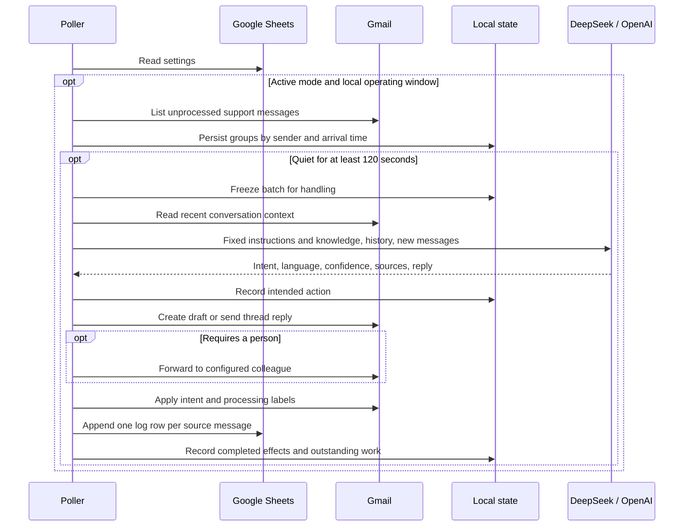

# BrewLab architecture

**Context.** The current batch preserves all source messages. The thread adapter caps recent history at 20 messages. The fixed prefix includes shop instructions and the Markdown knowledge. Keeping the prefix stable allows a supporting model to reuse it. Cache hits and model quality depend on the provider and input.

**Grounding.** The four files cover products, prices, shipping and returns, and frequent questions. The structured response includes sources and confidence. Unknown sources or missing evidence on a factual question trigger a handoff. A human agent can examine the source email, draft and log together.

**Recovery.** A single worker uses a local JSON journal. It records batch membership and remote actions separately, so restarting can finish labeling or logging without intentionally duplicating an acknowledged send. A remote timeout can leave the actual outcome unknown. Check Gmail’s sent mail and drafts and the log’s message ID before resolving an uncertain action. Preserve the state file during recovery. Operate one worker per mailbox and state file.

**Failure boundaries.** A read can be retried. A confirmed failure during reply generation or delivery can produce a fallback draft and admin alert. Gmail itself must be reachable to create either. The independent offline tests inject read failures, ambiguous writes, low-confidence decisions, service outages and restarts. They do not measure live OAuth, provider availability, model accuracy or inbox delivery.
