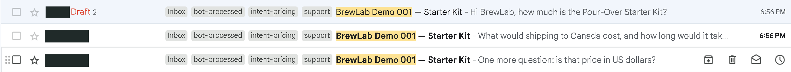
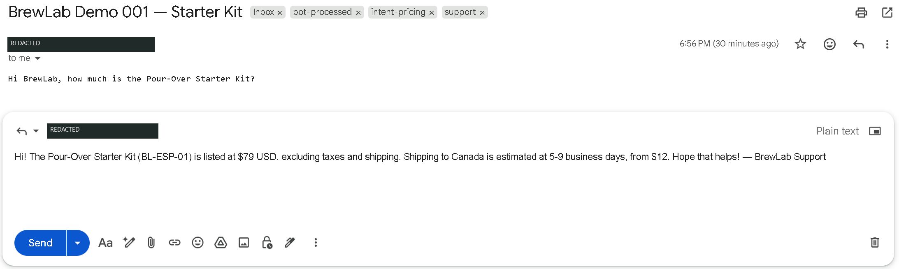
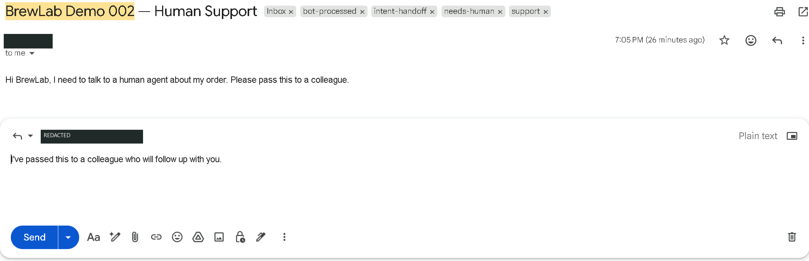
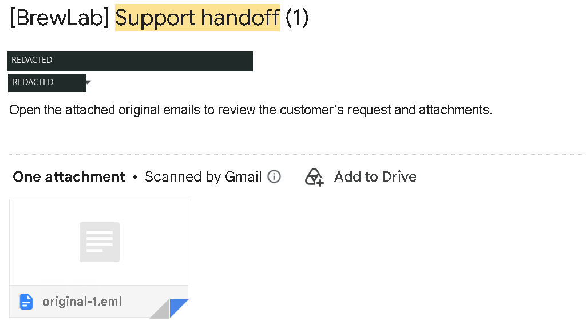
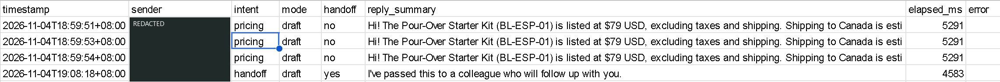
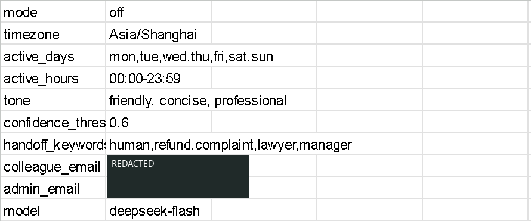

# Real Test Screenshots

These are real Gmail and Google Sheets screenshots from controlled testing on November 4, 2026. Private details are redacted. See [live validation](LIVE_VALIDATION.md) for the scope and limitations.

## Three emails one draft

## Merged reply

## Human handoff draft

## Forwarded original email

## Processing log

## Settings off

Three pricing audit rows correspond to one combined draft. The visible log summaries are excerpts. The settings snapshot shows the final off configuration, not a recording of the switch. The handoff is shown in Sent; recipient-side delivery was not independently confirmed.
